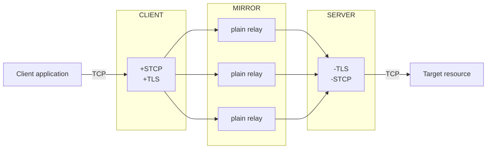
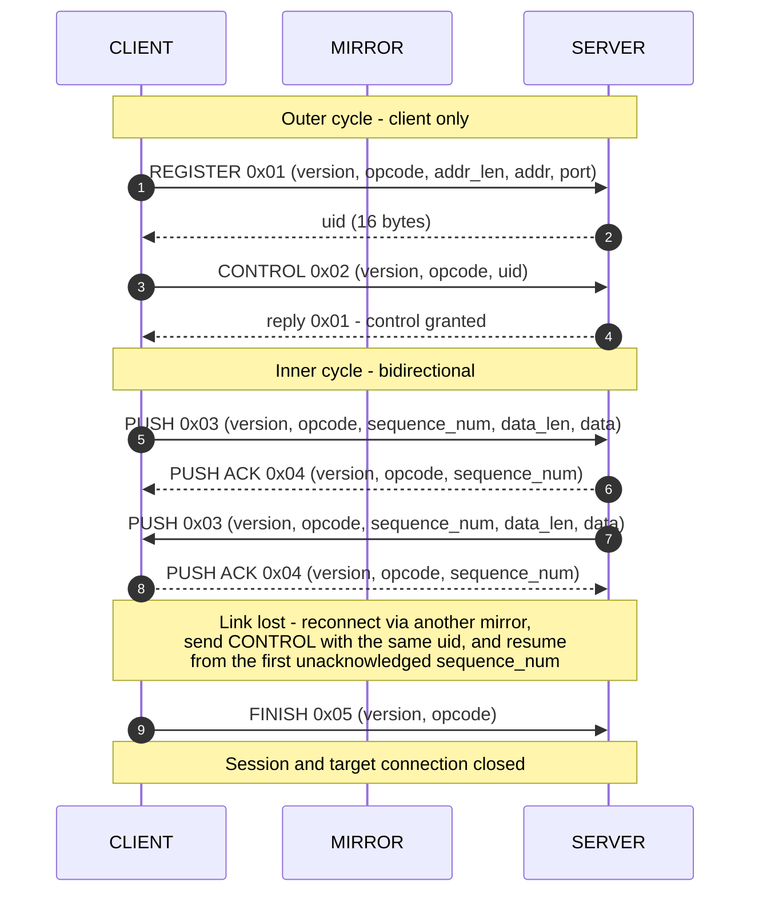

> [!WARNING]
> **This is an experimental project and is not intended for production use.**

# Secured STCP Proxy

**Secured STCP Proxy** - a fault-tolerant secure tunneling system built on TLS and a custom STCP protocol. It improves connection resilience and session continuity over unstable networks, keeping sessions alive across brief outages and route changes.



## 1. What is STCP?

**STCP (Seamless TCP)** - a custom transport-level framing and recovery protocol running over TCP. It adds session identification, sequence tracking, and acknowledgements so a logical session can survive underlying TCP disconnects.

| Operation | Code | Fields | Reply |
| --- | --- | --- | --- |
| `REGISTER` | `0x01` | `version` (1 B), `opcode` (1 B), `addr_len` (1 B), `addr` (variable), `port` (2 B) | `uid` - 16-byte session key |
| `CONTROL` | `0x02` | `version` (1 B), `opcode` (1 B), `uid` (16 B) | `reply` (1 B); `0x01` grants control, anything else closes the connection |
| `PUSH` | `0x03` | `version` (1 B), `opcode` (1 B), `sequence_num` (1 B), `data_len` (2 B), `data` (variable) | - |
| `PUSH ACK` | `0x04` | `version` (1 B), `opcode` (1 B), `sequence_num` (1 B) | - |
| `FINISH` | `0x05` | `version` (1 B), `opcode` (1 B) | - |

## 2. How does it work?

The core logic is defined by the session lifecycle:

1. **Register.** The client sends `REGISTER` with the target address and port and receives a 16-byte `uid` (the session key).
2. **Take control.** The client sends `CONTROL` with that `uid`. A `0x01` reply grants control and transitions the connection into the inner data cycle.
3. **Transfer data.** Each `PUSH` carries a `sequence_num` and is retained until the peer acknowledges it with `PUSH ACK`; the sequence number advances only after acknowledgement.
4. **Recover.** If the underlying connection drops, the client opens a new connection - typically through a different mirror - sends `CONTROL` with the same `uid`, and resumes from the first unacknowledged `sequence_num`.
5. **Finish.** `FINISH` tears down the session on both ends and closes the connection to the target resource.



## 3. Running the system

Container images are published to GitHub Container Registry and referenced in `docker-compose.yaml`. Pull the images and start the environment in the background:

```bash
docker compose up -d
```

Verify that all containers are running:

```bash
docker compose ps
```

Send traffic through the local SOCKS5 proxy on `127.0.0.1:2080`:

```bash
curl --socks5 127.0.0.1:2080 google.com
```

To test failover, find the mirror currently handling the session (it logs `New session`) and stop it:

```bash
docker compose logs --tail=5 mirror1 mirror2 mirror3
docker compose stop <active_mirror>
```

The client reconnects through another available mirror and resumes from the first unacknowledged `sequence_num`.

Stop and remove all containers and networks:

```bash
docker compose down
```

## 4. Configuration (ssp-client)

The client reads `config.json` from its working directory and `cert.crt` for the TLS root certificate.

| Parameter | Type | Description |
| --- | --- | --- |
| `host` | string | Address the SOCKS5 listener binds to, for example `0.0.0.0:2080`. |
| `servers` | []string | Mirror endpoints. One of them is chosen at random for every new connection, skipping the mirror that just failed. |
| `attempts` | int | Maximum number of reconnect attempts before the session is abandoned. |
| `timeout` | int | Seconds to wait for a response from a mirror or the server. |
| `log_level` | int | `slog` verbosity: `-4` debug, `0` info, `4` warn, `8` error. |

```json
{
  "host": "0.0.0.0:2080",
  "servers": [
    "mirror1:443",
    "mirror2:443",
    "mirror3:443"
  ],
  "attempts": 5,
  "timeout": 5,
  "log_level": 0
}
```

## 5. Configuration (ssp-server)

The server reads `config.json` from its working directory, plus `cert.crt` and `cert.key` for TLS.

| Parameter | Type | Description |
| --- | --- | --- |
| `host` | string | Address the TLS listener binds to, for example `0.0.0.0:443`. |
| `timeout` | int | Seconds to wait for a response from the target resource. |
| `log_level` | int | `slog` verbosity: `-4` debug, `0` info, `4` warn, `8` error. |

```json
{
  "host": "0.0.0.0:443",
  "timeout": 5,
  "log_level": 0
}
```

## 6. Configuration (ssp-mirror)

The mirror reads `config.json` from its working directory.

| Parameter | Type | Description |
| --- | --- | --- |
| `host` | string | Address the relay listens on, for example `0.0.0.0:443`. |
| `target` | string | Next hop in the chain, normally `server:443`. |
| `timeout` | int | Seconds to wait for the target to accept a connection. |
| `log_level` | int | `slog` verbosity: `-4` debug, `0` info, `4` warn, `8` error. |

```json
{
  "host": "0.0.0.0:443",
  "target": "server:443",
  "timeout": 5,
  "log_level": 0
}
```

## 7. Test services

Two lightweight web services are included to exercise the tunnel without an external target. They are not part of the tunnel itself and have no configuration files: the listen port is fixed at `8080` inside the container, and the published host port is set in `docker-compose.yaml`.

| Service | Image | Host port | Purpose |
| --- | --- | --- | --- |
| `test-sequence` | `ssp-test-sequence` | `8081` | Streams `0`, `1`, `2`, ... one value per second. A gap in the sequence means the tunnel lost or reordered data. |
| `test-128mb` | `ssp-test-128mb` | `8082` | Returns exactly 128 MiB (`134217728` bytes) of data. Used to check throughput and to confirm that large transfers survive a link switch. |
